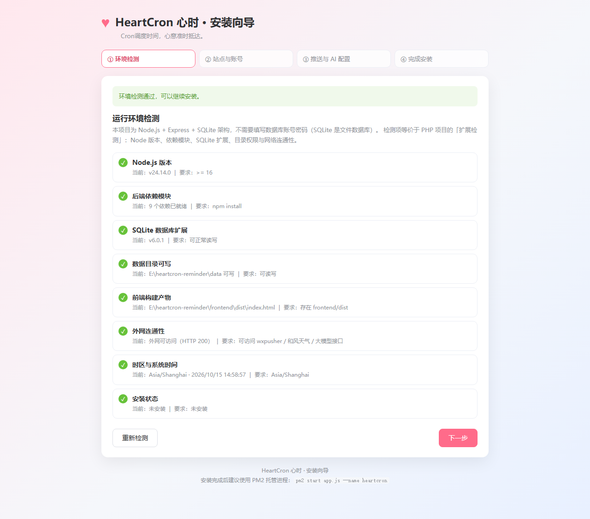
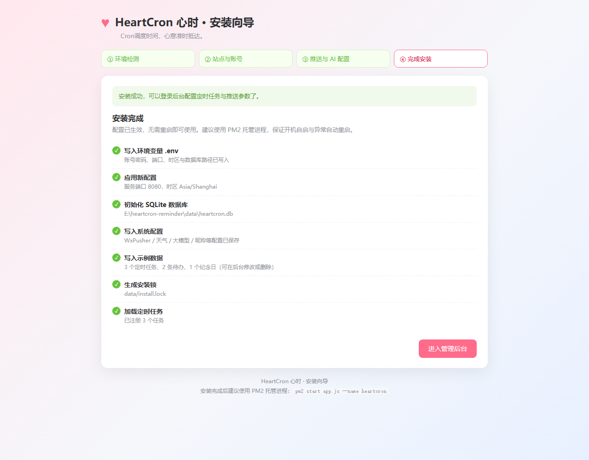
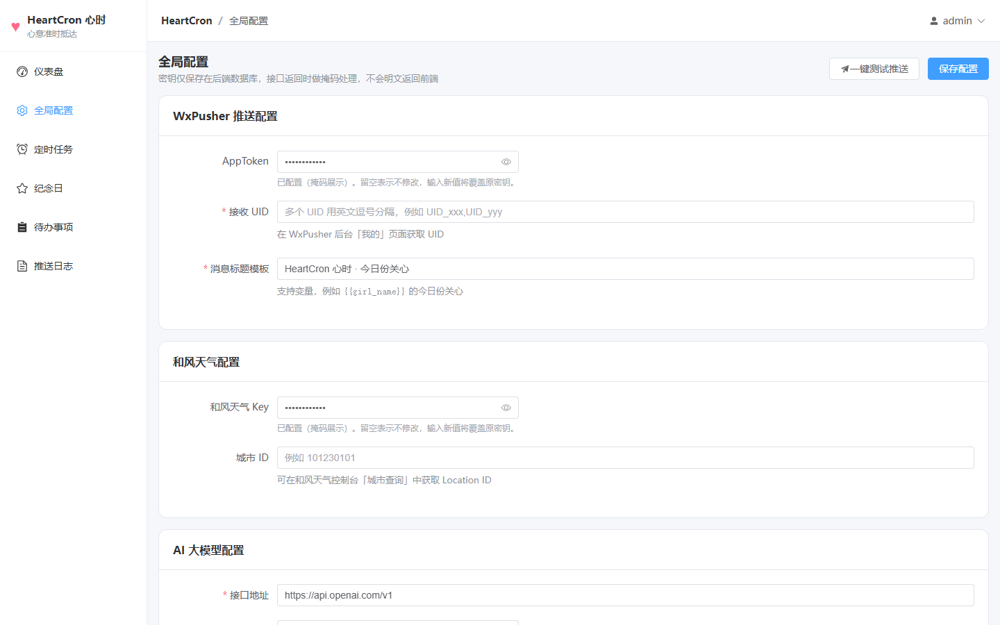
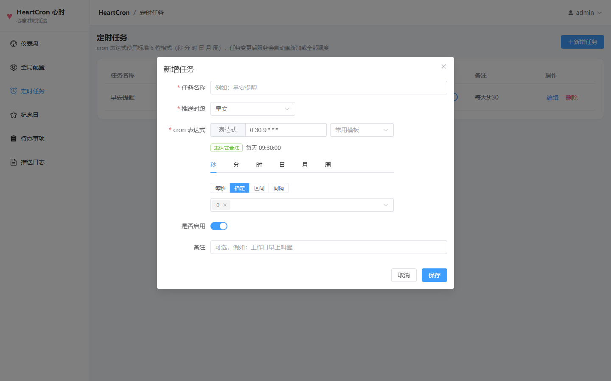

# HeartCron 心时

**Cron调度时间，心意准时抵达。**

HeartCron（心时）是一个 AI 暖心定时提醒 Web 系统，基于开源项目 Vitality-reminder 二次开发。
它会在设定时间自动获取天气信息、读取纪念日倒计时，结合你配置的待办事项，调用大模型生成每天不一样的关心文案，并通过 WxPusher 推送到微信。

代码本无温度，但可以用来准时传递温柔。

## 功能特性

- 🕒 多组定时任务，支持可视化 Cron 配置
- 🌤 和风天气接入，自动获取气温、天气状况、降水、预警等信息
- 💖 纪念日管理，自动计算倒计时并融入文案
- 📝 每日待办清单，支持自定义提醒内容，支持仅工作日推送
- 🤖 AI 大模型生成文案，每天内容不同，支持自定义 Prompt 模板
- 📡 WxPusher 微信消息推送
- 🖥 Vue3 + Element Plus Web 可视化管理后台
- 📜 推送历史日志记录，查看每一次推送详情
- 🧪 支持一键测试推送，快速验证整套推送链路

## 技术栈

| 层次 | 技术 |
| --- | --- |
| 后端 | Node.js + Express |
| 前端 | Vue3 + Vite + Element Plus + vue-router + axios |
| 数据库 | SQLite（sqlite3） |
| 定时任务 | node-schedule + cron-parser |
| 第三方服务 | 和风天气、兼容 OpenAI 格式的大模型 API、WxPusher |

## 界面预览

安装向导（上传代码后访问 `/install`，自动检测环境并完成初始化）：

| 环境检测 | 完成安装 |
| --- | --- |
|  |  |

管理后台：

| 仪表盘 | 全局配置 |
| --- | --- |
|  |  |

| 定时任务 | cron 可视化选择 |
| --- | --- |
|  |  |

| 推送日志 | |
| --- | --- |
|  | |

## 目录结构

```
heartcron-reminder/
├── app.js                     # 后端入口：Express 服务 + 静态资源托管 + 定时任务加载
├── package.json               # 后端依赖与脚本
├── .env.example               # 环境变量示例（复制为 .env 使用）
├── data/                      # SQLite 数据库文件目录（自动创建，已加入 .gitignore）
├── scripts/
│   └── init-db.js             # 数据库初始化脚本：建表 + 预置默认配置与 Prompt
├── src/
│   ├── config/
│   │   ├── index.js           # 运行时配置（端口、时区、数据库路径、登录账号）
│   │   ├── constants.js       # 业务常量（推送时段、文案风格、字段白名单）
│   │   └── defaultPrompt.js   # 默认 AI 提示词模板与兜底文案
│   ├── db/
│   │   ├── index.js           # SQLite 访问层（Promise 化封装）
│   │   └── schema.sql         # 5 张表的建表语句
│   ├── middleware/
│   │   ├── auth.js            # 登录鉴权中间件
│   │   └── errorHandler.js    # 404 与统一异常处理
│   ├── routes/
│   │   ├── index.js           # 路由总入口
│   │   ├── auth.js            # 登录 / 退出 / 会话
│   │   ├── install.js         # 网页安装向导接口（免登录，安装后自动关闭）
│   │   ├── config.js          # 系统配置读写（密钥掩码）
│   │   ├── task.js            # 定时任务 CRUD
│   │   ├── anniversary.js     # 纪念日 CRUD
│   │   ├── todo.js            # 待办事项 CRUD
│   │   ├── log.js             # 推送日志分页查询
│   │   └── push.js            # 一键测试推送 / 仪表盘预览 / 元信息
│   ├── services/
│   │   ├── installer.js       # 安装向导：环境检测 / 写 .env / 初始化数据库
│   │   ├── weather.js         # 和风天气（实时 + 今日预报 + 预警）
│   │   ├── ai.js              # 大模型调用（OpenAI 兼容）
│   │   ├── wxpusher.js        # WxPusher 推送
│   │   ├── prompt.js          # {{变量}} 模板渲染
│   │   ├── anniversary.js     # 纪念日倒计时文本
│   │   ├── todo.js            # 待办筛选（含仅工作日）
│   │   ├── push.js            # 推送主链路（定时任务与测试推送共用）
│   │   └── scheduler.js       # node-schedule 任务注册与重载
│   └── utils/                 # 日志、HTTP、掩码、日期、asyncHandler 等工具
├── public/
│   └── install.html           # 网页安装向导页面（单文件，无需构建即可访问）
├── frontend/                  # Vue3 管理后台
│   ├── vite.config.js         # 开发代理 /api → http://localhost:8080
│   ├── index.html
│   └── src/
│       ├── main.js            # 入口：Element Plus + 图标 + 路由
│       ├── App.vue
│       ├── api/index.js       # 接口封装（统一错误提示与 401 跳转）
│       ├── router/index.js    # 路由与登录守卫
│       ├── layout/AdminLayout.vue      # 侧边导航 + 面包屑布局
│       ├── components/
│       │   ├── CronPicker.vue          # cron 可视化选择器
│       │   ├── SecretInput.vue         # 密钥掩码输入框
│       │   └── PushResultDialog.vue    # 测试推送结果弹窗
│       ├── utils/             # cron 工具、格式化工具、登录态
│       └── views/             # 登录 / 仪表盘 / 配置 / 任务 / 纪念日 / 待办 / 日志
└── legacy/vitality-reminder/  # 二次开发前的原始 Vitality-reminder 代码（保留备查）
```

## 快速开始

### 1. 安装依赖

```bash
git clone https://github.com/你的用户名/heartcron-reminder.git
cd heartcron-reminder
npm install
```

> Node.js >= 16。项目使用 `sqlite3` v6（提供 Node 20+ 的预编译二进制），在较旧的 Node 版本上安装时可能需要本地编译工具链，建议直接使用 Node 20 及以上版本。

### 2. 配置环境变量（两种方式二选一）

方式 A（推荐）：启动服务后用浏览器打开 `/install` 网页安装向导，按提示填写账号密码与各项密钥，向导会自动生成 `.env` 并初始化数据库。

方式 B：手动复制并编辑 `.env`：

```bash
cp .env.example .env    # Windows: copy .env.example .env
```

`.env` 支持的变量：

| 变量 | 说明 | 默认值 |
| --- | --- | --- |
| `PORT` | 服务端口 | 8080 |
| `ADMIN_USERNAME` | 后台登录账号 | admin |
| `ADMIN_PASSWORD` | 后台登录密码 | heartcron123 |
| `SESSION_SECRET` | 会话加密密钥 | 需自行修改 |
| `SESSION_MAX_AGE` | 会话有效期（毫秒） | 7 天 |
| `DB_PATH` | SQLite 文件路径 | data/heartcron.db |
| `TZ` | 定时任务时区 | Asia/Shanghai |
| `HTTP_TIMEOUT` | 外部请求超时（毫秒） | 10000 |

### 3. 初始化数据库（网页向导会自动完成，手动部署时执行）

```bash
npm run init-db
```

脚本会创建 `data/heartcron.db`、建好 5 张表，并写入默认系统配置与默认 Prompt 模板。重复执行不会覆盖已有数据。

### 4. 构建前端

```bash
npm run build          # 等价于 cd frontend && npm install && npm run build
```

构建产物输出到 `frontend/dist`，由后端 Express 直接托管，访问 `http://localhost:8080` 即可。

本地调试前端时也可以单独运行：

```bash
cd frontend && npm run dev   # 访问 http://localhost:5173，/api 自动代理到 8080
```

### 5. 启动服务

```bash
npm start
```

生产环境建议使用 PM2 托管进程：

```bash
npm install -g pm2
pm2 start app.js --name heartcron
pm2 save
pm2 logs heartcron
```

### 6. 打开安装向导 / 登录后台

1. 打开 `http://服务器地址:8080`，未安装时会自动跳转到安装向导 `/install`
2. 按向导完成「环境检测 → 站点与账号 → 推送与 AI 配置 → 完成安装」
3. 使用向导中设置的账号密码登录后台
4. 进入「全局配置」补充 WxPusher、和风天气与大模型参数（向导中已填写的会保留）
5. 点击「一键测试推送」验证链路，然后到「定时任务」「纪念日」「待办事项」配置内容

## 服务器部署（上传即用）

部署到自己的服务器只需要：**上传代码 → 安装依赖 → 启动服务 → 浏览器打开安装向导**，不需要手工建库、改配置文件。

```bash
# 1. 上传代码到服务器（git clone 或直接上传压缩包后解压）
cd /www/wwwroot/heartcron-reminder

# 2. 安装后端依赖（生产环境可加 --omit=dev）
npm install --omit=dev

# 3. 构建前端（本地构建后上传 frontend/dist 也可以）
npm run build

# 4. 用 PM2 常驻启动
npm install -g pm2
pm2 start app.js --name heartcron
pm2 save && pm2 startup

# 5. 浏览器打开安装向导
#    http://服务器IP:8080/install
```

### 安装向导做了什么

未安装时访问任意地址都会自动跳转到 `/install`，接口返回 `503 NOT_INSTALLED`；安装完成后向导会自动关闭（再次访问只显示「系统已安装」）。

| 步骤 | 说明 |
| --- | --- |
| ① 环境检测 | Node 版本、后端依赖模块、SQLite 扩展可用性、数据目录写权限、前端构建产物、外网连通性、时区 |
| ② 站点与账号 | 服务端口、时区、数据库文件路径、管理员账号密码、SESSION_SECRET |
| ③ 推送与 AI 配置 | WxPusher、和风天气、大模型参数与昵称（可跳过，后台再填） |
| ④ 完成安装 | 写入 `.env`、建表、写入配置与示例数据、生成 `data/install.lock`、注册定时任务 |

向导执行过程中会备份原有 `.env` 为 `.env.bak`；配置写入后会**热加载生效，无需重启进程**。

> 本项目是 Node.js + SQLite 架构，**不需要填写数据库主机、账号、密码**（SQLite 是单文件数据库，向导里只需要选一个数据库文件路径）。若需要 MySQL 版本，需要另行改造数据访问层。

### 重新安装

删除项目目录下的 `data/install.lock`，刷新 `/install` 页面即可重新运行向导（重新安装会覆盖 `.env` 与数据库中的系统配置，业务数据表不受影响）。

### 宝塔面板部署

1. 在「软件商店」安装 **Node.js 版本管理器**（Node 20 或更高）与 **PM2 管理器**
2. 把项目上传到 `/www/wwwroot/heartcron-reminder`，或直接用 Git 拉取
3. 终端进入项目目录执行 `npm install --omit=dev && npm run build`
4. 在「PM2 管理器」中添加项目：启动文件选 `app.js`，运行目录选项目根目录，端口填 8080
5. 在「网站 → 添加站点」里把域名反向代理到 `http://127.0.0.1:8080`，并在「安全」中放行端口
6. 浏览器访问 `http://你的域名/install` 完成安装向导

### Nginx 反向代理示例

```nginx
server {
    listen 80;
    server_name heartcron.example.com;

    location / {
        proxy_pass http://127.0.0.1:8080;
        proxy_http_version 1.1;
        proxy_set_header Host $host;
        proxy_set_header X-Real-IP $remote_addr;
        proxy_set_header X-Forwarded-For $proxy_add_x_forwarded_for;
        proxy_set_header X-Forwarded-Proto $scheme;
    }
}
```

### PM2 常用命令

```bash
pm2 start app.js --name heartcron   # 启动
pm2 restart heartcron               # 重启（修改 .env 后需要重启）
pm2 logs heartcron                  # 查看日志
pm2 status                          # 查看状态
pm2 delete heartcron                # 删除进程
```

### 部署注意事项

- 服务器需要能访问外网：`wxpusher.zjiecode.com`、`devapi.qweather.com`、你配置的大模型接口地址
- 记得在云服务器安全组 / 防火墙放行服务端口（默认 8080）
- 前端构建产物 `frontend/dist` 未上传时，只能访问接口与安装向导，请在服务器执行 `npm run build`
- 未配置 HTTPS 时，登录 Cookie 不带 Secure 标记；对外网开放建议用 Nginx 配置 HTTPS

## 手动安装（不用向导时）

如果已经按「快速开始」的步骤 1~5 手动配置好 `.env` 并执行过 `npm run init-db`，就不需要走安装向导，直接登录后台即可：

1. 打开 `http://服务器地址:8080`，使用 `.env` 中的账号密码登录
2. 进入「全局配置」填写 WxPusher AppToken / UID、和风天气 Key / 城市 ID、大模型接口地址与 Key
3. 点击「一键测试推送」验证链路是否打通
4. 到「定时任务」「纪念日」「待办事项」页面配置内容，任务启用后立即生效

## 数据库表结构

建表语句见 [src/db/schema.sql](src/db/schema.sql)，共 5 张表：

| 表名 | 说明 | 关键字段 |
| --- | --- | --- |
| `system_config` | 系统全局配置（单行，id=1） | wx_pusher_*、qweather_*、ai_*、ai_prompt_template、boy_name、girl_name、default_style |
| `remind_task` | 定时任务 | task_name、cron_expr、push_time_period、enable、remark |
| `anniversary` | 纪念日 | name、target_date、enable、show_countdown |
| `todo_item` | 待办事项 | content、enable、only_workday |
| `push_log` | 推送日志 | create_time、weather_info、ai_content、status、error_msg、task_id |

## 接口列表

除登录接口外，全部接口都需要登录会话（Cookie），未登录返回 401。

| 方法 | 路径 | 说明 |
| --- | --- | --- |
| POST | `/api/login` | 登录，账号密码来自 `.env` |
| POST | `/api/logout` | 退出登录 |
| GET | `/api/session` | 查询当前登录状态 |
| GET | `/api/config` | 获取全部配置（密钥掩码返回） |
| PUT | `/api/config` | 更新配置（提交掩码值表示不修改该密钥） |
| GET/POST/PUT/DELETE | `/api/task[/:id]` | 定时任务增删改查 |
| GET/POST/PUT/DELETE | `/api/anniversary[/:id]` | 纪念日增删改查 |
| GET/POST/PUT/DELETE | `/api/todo[/:id]` | 待办事项增删改查 |
| GET | `/api/log?page=1&size=10` | 推送日志分页查询 |
| POST | `/api/test-push` | 一键测试推送，执行完整链路 |
| GET | `/api/preview` | 仪表盘今日预览（不推送） |
| GET | `/api/meta` | 前端下拉选项、时区、已注册任务数 |
| GET | `/healthz` | 健康检查 |

安装向导相关接口（免登录，仅未安装时可调用）：

| 方法 | 路径 | 说明 |
| --- | --- | --- |
| GET | `/install` | 安装向导页面 |
| GET | `/api/install/status` | 安装状态与环境检测结果 |
| POST | `/api/install/check` | 重新执行环境检测 |
| POST | `/api/install/run` | 执行安装（写 .env、建表、写入初始配置） |

## 推送流程

```
定时触发（node-schedule）
  ↓ 读取 system_config 全部配置
  ↓ 请求和风天气 API，整理天气信息
  ↓ 读取纪念日列表，计算倒计时文本
  ↓ 读取今日待办（含仅工作日过滤）
  ↓ 渲染后台配置的 Prompt 模板（替换所有 {{变量}}）
  ↓ 请求大模型生成暖心文案（失败自动使用内置备用文案）
  ↓ 调用 WxPusher 推送微信消息
  ↓ 写入 push_log 推送日志（成功/失败、文案、时间、错误信息）
```

## Prompt 变量

后台「全局配置 → AI 提示词模板」支持以下变量，生成文案前会自动替换：

| 变量 | 说明 |
| --- | --- |
| `{{boy_name}}` | 你的昵称 |
| `{{girl_name}}` | 她的昵称 |
| `{{today_date}}` | 今日日期（含星期） |
| `{{weather_info}}` | 天气信息 |
| `{{anniversary_list}}` | 纪念日倒计时列表 |
| `{{todo_list}}` | 今日待办事项 |
| `{{push_time_period}}` | 推送时段（早安 / 午间关心 / 晚安提醒） |
| `{{style_type}}` | 文案风格（温柔治愈 / 简短清爽 / 俏皮可爱） |

## cron 表达式说明

任务使用标准 6 位 cron 表达式：`秒 分 时 日 月 周`，例如：

- `0 30 9 * * *`：每天 09:30:00
- `0 30 8 * * 1-5`：工作日 08:30:00
- `0 0 10 5 * *`：每月 5 号 10:00:00

前端「定时任务」弹窗内提供可视化选择器（每 / 指定 / 区间 / 间隔），也可以直接编辑表达式。

> 说明：需求文档建议使用 `vue3-cron` 组件，但该 npm 包发布产物缺少 `lib/vue3Cron.umd.js` 入口文件，安装后无法被构建工具解析。因此本项目实现了等价的本地组件 `frontend/src/components/CronPicker.vue`，直接产出后端可用的标准 6 位表达式（`vue3-cron` 生成的是 Quartz 风格 7 位表达式，与 node-schedule 并不兼容）。

## 安全说明

- WxPusher Token、和风天气 Key、大模型 API Key 仅存储在后端 SQLite，接口返回时统一掩码（如 `sk-a****cdef`），前端不接触明文
- 更新配置时提交掩码值表示「不修改原密钥」，留空同样保持原值
- 全部业务接口都经过登录校验，登录失败 10 次锁定该 IP 5 分钟
- 所有外部 HTTP 请求都设置超时与异常捕获，失败会降级写入推送日志

## 常见问题

**推送失败提示「未配置 WxPusher UID」**：请在 WxPusher 后台关注应用并获取 UID，填入全局配置。

**天气显示「（未配置和风天气…）」**：填写和风天气 Key 与城市 ID（Location ID）后即可，天气获取失败不会阻断推送。

**AI 文案像是模板**：说明大模型调用失败并走了内置备用文案，可在推送日志的「错误信息」中查看具体原因（常见为 API Key 无效、模型名称不存在、余额不足）。

**修改任务后什么时候生效**：任务增删改与启停都会立即重新加载全部调度，无需重启服务。

**访问 /install 显示「系统已安装」**：说明 `data/install.lock` 已存在，属于正常的防重复安装保护；需要重新安装时删除该文件再刷新页面。

**安装向导里需要填数据库地址吗**：不需要。项目使用 SQLite 单文件数据库，向导里只选择数据库文件路径（默认 `data/heartcron.db`），没有主机、账号、密码这些概念。

**安装后改了端口没生效**：端口在进程启动时监听，改完 `.env` 需要重启服务（`pm2 restart heartcron`）；其余配置（密钥、Prompt、任务）都是即时生效的。

## License

本项目基于原 Vitality-reminder 开源协议进行二次开发，仅供个人学习与非商用使用。
