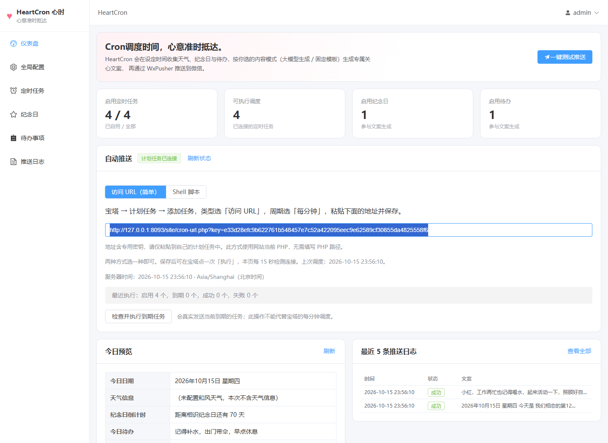
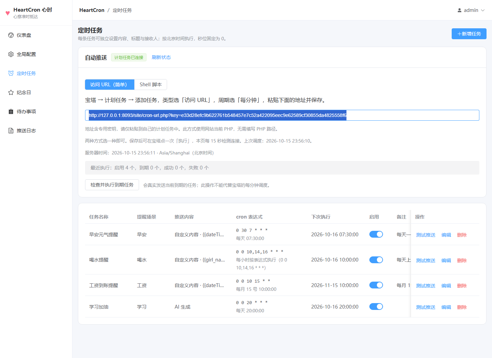
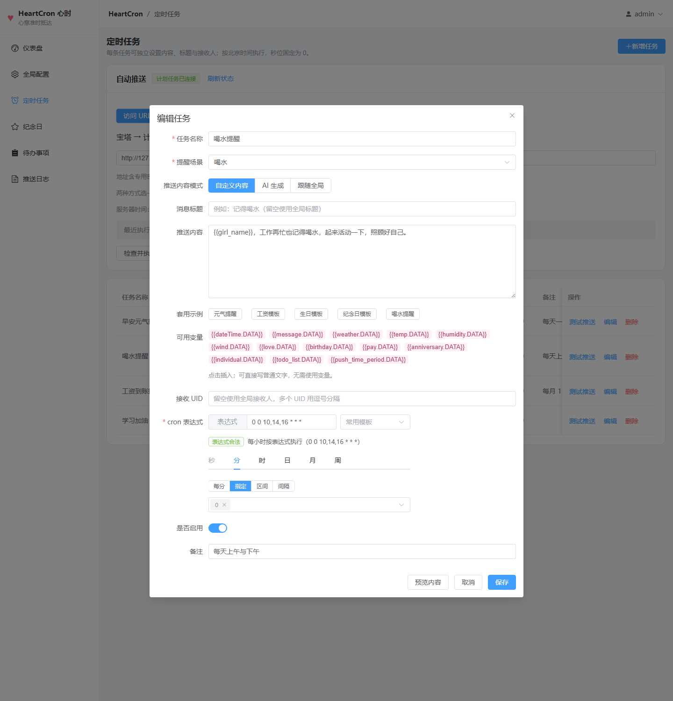
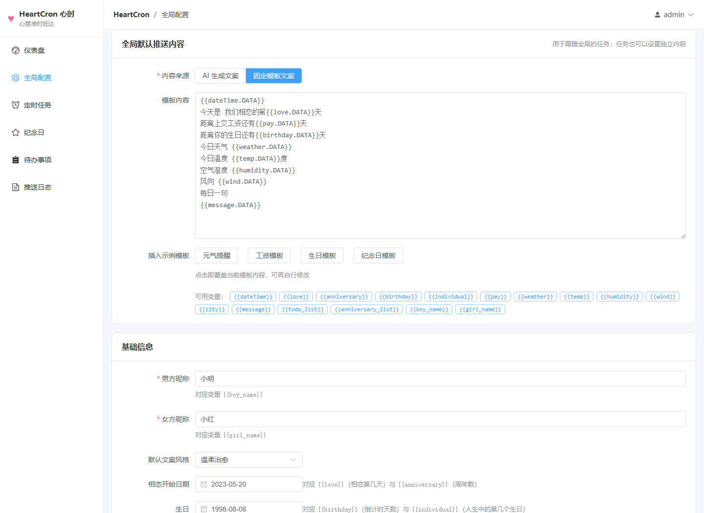
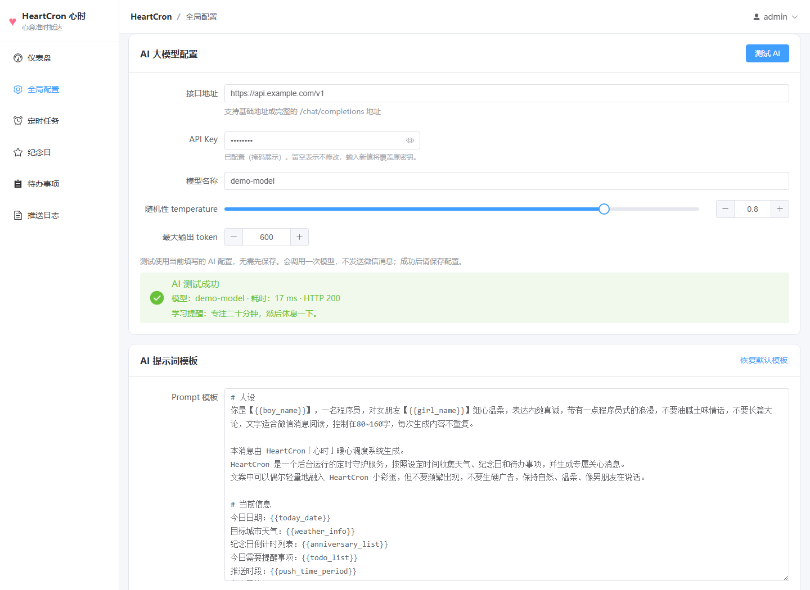
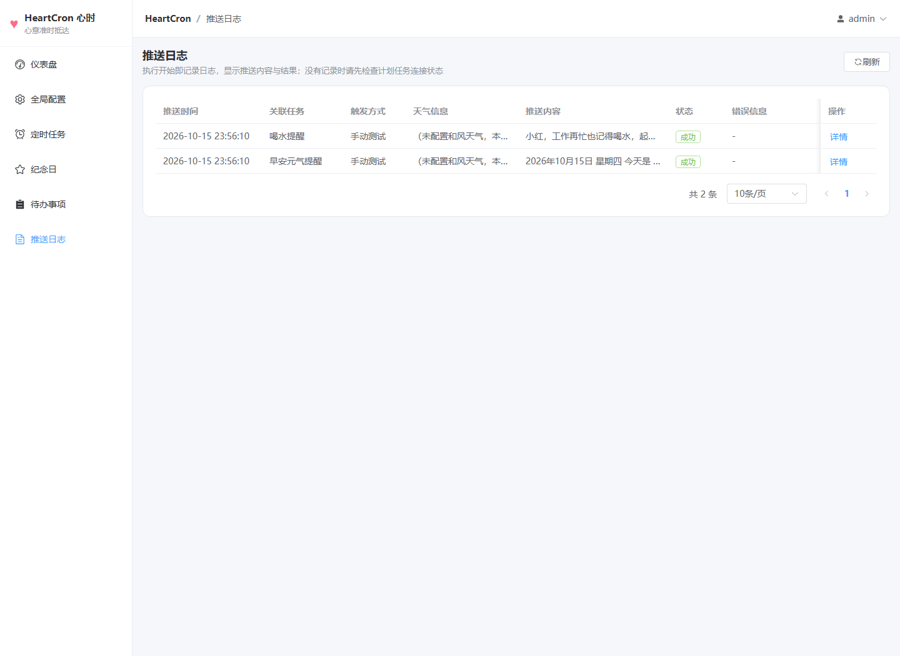
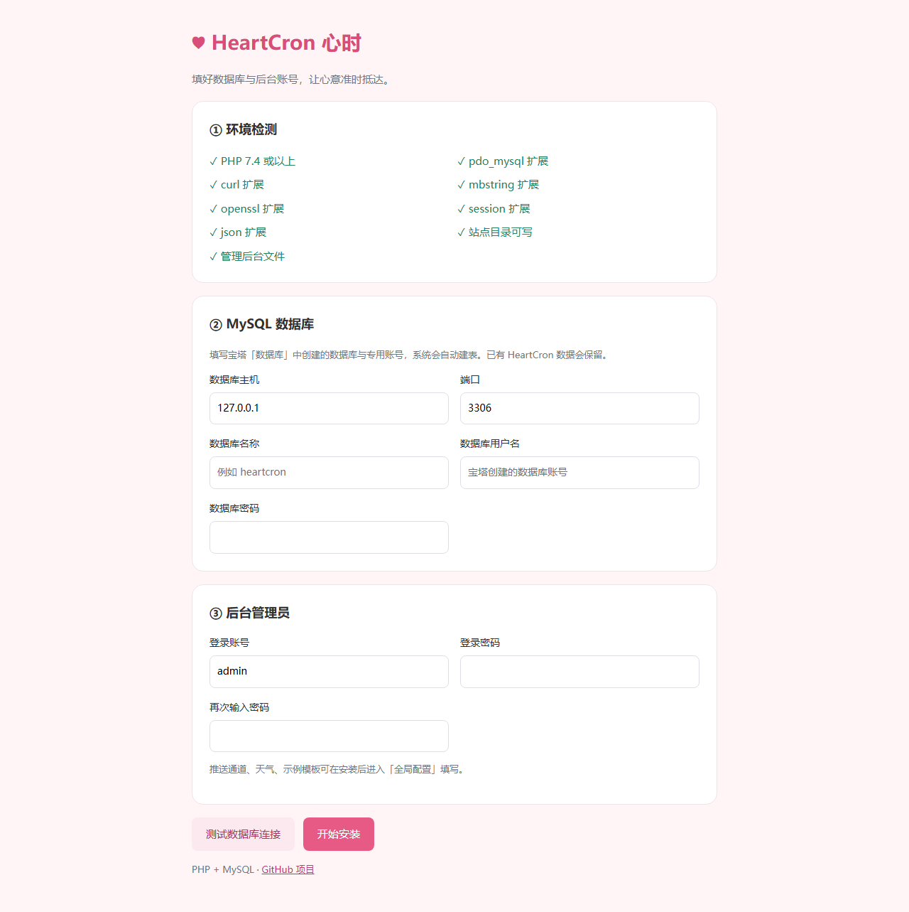

# HeartCron 心时

**Cron 调度时间，心意准时抵达。**

一个可以直接上传到 PHP 网站的暖心提醒系统：自动获取天气、记住纪念日和待办，用固定模板或 AI 生成关心文案，通过 WxPusher 推送到微信。

[](https://github.com/dou-jiang/heartcron-reminder)

[项目主页](https://github.com/dou-jiang/heartcron-reminder) · [下载 PHP 上传包](https://github.com/dou-jiang/heartcron-reminder/releases/latest) · [问题反馈 / 功能建议](https://github.com/dou-jiang/heartcron-reminder/issues)

> 还没有女朋友？也可以先用它照顾好自己，提醒吃饭、带伞、早点休息。等喜欢的人出现，把这份细心送给对方。希望 HeartCron 能助你一臂之力，早日脱单 ❤

## 界面演示

以下为 PHP 版后台截图，使用演示数据与本地模拟接口展示功能，不代表真实微信投递或第三方 AI 服务的连接结果。

**仪表盘：今日预览、调度连接状态与最近推送记录**



**定时任务：每条任务独立设置文案、提醒时间与接收人**



<details>
<summary>展开更多演示：独立任务文案、固定模板、AI 测试与推送日志</summary>

**编辑任务与自定义推送内容**



**全局默认模板与一键套用示例**



**AI 连接测试：生成内容、耗时与返回状态**



**推送日志：执行状态、内容与详情**



</details>

## 宝塔部署：创建 PHP 站点，上传安装

1. **准备环境**：在宝塔安装 PHP（兼容 7.4+，建议选 8.2 或 8.3）和 MySQL；在「数据库」中新建一个数据库，记下库名、用户名与密码。
2. **上传文件**：在「网站 → PHP 项目 → 添加站点」创建网站。下载 [PHP 上传包](https://github.com/dou-jiang/heartcron-reminder/releases/latest)，上传并解压到站点根目录；根目录应直接看到 `index.php` 和 `install.php`。运行目录选站点根目录。
3. **网页安装**：访问你的域名，自动进入安装向导。填写数据库和后台账号，点击「开始安装」，完成后登录后台。

上传包已包含打包好的后台。无需安装 Node.js、Composer、PM2，无需构建前端，也无需设置反向代理或伪静态。也可以下载整个仓库，解压后把内层项目文件上传到站点根目录。

安装页自动检测 PHP 版本、pdo_mysql、curl、mbstring、openssl、session、json、目录权限和后台文件；自动创建数据表，生成服务器配置 `config.php`。数据库不存在时会尝试创建，账号没有建库权限则先在宝塔建库即可。



### 开启自动推送（设置一次）

PHP 网站的后台可以直接访问；要在无人访问网站时也准时推送，需要添加一次宝塔计划任务：

1. 后台「仪表盘 → 自动推送」，选择 **访问 URL（简单）**，复制页面生成的完整地址。
2. 宝塔「计划任务 → 添加任务」，类型选 **访问 URL**，执行周期选 **每分钟**，粘贴地址并保存。
3. 在宝塔点一次「执行」，或等待一分钟。后台每 15 秒检测，显示「计划任务已连接」即接入成功；再查看执行结果和推送日志。

生成的地址含有随机密钥，请保密。URL 方式使用网站当前 PHP，无需找 PHP 路径。若服务器无法访问自己的域名，也可以在后台切换 **Shell 脚本**，复制命令到宝塔 Shell 计划任务；两种方式选一种即可。

命令示例（实际命令会根据站点路径和 PHP 版本生成）：

```bash
/www/server/php/83/bin/php '/www/wwwroot/你的站点/cron.php'
```

网站与计划任务均按 `Asia/Shanghai` 时区运行。任务按分钟执行，6 位 cron 的秒位必须是 `0`。同一任务在同一分钟只认领一次，URL 与 Shell 共用防重复机制。短暂延迟不超过五分钟时，会补查漏掉的分钟；长时间停机后只检查当前分钟，避免集中补发。

后台显示「等待宝塔计划任务」表示尚未收到外部调度，保存任务本身不会自动执行或生成日志。「检查并执行到期任务」可手动检查并真实发送到期任务，不能代替每分钟调度。每次推送先记录「处理中」，再更新成功或失败；异常中断超过十分钟会标为「发送结果未知」，便于排查。

## 功能

- Vue3 + Element Plus 管理后台，页面刷新无需伪静态。
- 网页安装、环境检测、MySQL 连接检测、自动建表。
- 多组定时任务，可视化 Cron 编辑、启停与下次执行时间；调度连接状态、执行统计和一键检查。
- 每条任务独立设置文案、标题、接收 UID 或 AI 提示词，支持喝水、吃药、学习等任意提醒场景；内容预览和本任务测试推送。
- 和风天气：实时天气、温度、湿度、风向、预报和预警。
- 纪念日倒计时、每日待办、仅工作日提醒。
- 固定模板推送：元气提醒、工资、生日、纪念日四套示例一键套用。
- AI 文案：兼容聊天补全格式的接口、自定义提示词；独立「测试 AI」按钮，显示生成内容、耗时与错误原因；实际推送失败时使用内置备用文案。
- WxPusher 微信推送，支持多个 UID、一键测试和推送日志。
- 管理员密码哈希、会话登录、CSRF 校验、登录失败限流、密钥掩码。

## 首次使用

进入「全局配置」填写 WxPusher AppToken 和接收 UID，点击保存。默认使用固定模板，不填 AI 参数也能推送。

按需填写相恋开始日期、生日、发薪日与每日一句；需要天气时填写和风天气的 **API Host、Key、城市 ID**。使用 AI 模式时再填写接口地址、API Key、模型与提示词。

点击「一键测试推送」验证已保存的全局配置，再到「定时任务」添加需要的时间。新增任务默认「自定义内容」，直接填写要发送的话，也可以套用元气、工资、生日、纪念日示例。每条任务可选择「AI 生成」并填写自己的提示词，或选择「跟随全局」。标题和 UID 留空时使用全局配置。

工资、生日、纪念日模板是内容示例，仍需设置对应日期。例如工资任务每月 15 日 10:00，生日任务每年 8 月 8 日 09:00，两条任务可以分别保存自己的模板，无需在推送前切换全局内容。旧版本任务升级后默认「跟随全局」，编辑即可改成独立文案。

### 测试 AI

在「全局配置 → AI 大模型配置」填写接口地址、API Key、模型名称，点击 **测试 AI**。使用当前填写的参数，无需先保存，也不要求先填 WxPusher；未修改的掩码密钥会使用已保存的真实密钥。测试会调用一次模型，不发送微信、不产生推送日志、不自动保存配置，成功后记得点击「保存配置」。

接口支持基础地址（例如 `https://你的接口/v1`）或完整的 `https://你的接口/v1/chat/completions`，请求使用 Chat Completions JSON 格式。测试结果显示生成内容、耗时或具体错误：401 常见于密钥无效，403 为权限问题，404 为地址或模型不存在，429 为频率限制或额度不足；网络、证书、无效 JSON 和空内容也会明确提示。测试失败不会使用备用文案冒充 AI 成功。

## 示例模板

后台「定时任务 → 新增 / 编辑 → 自定义内容」可单独保存下面的模板；也可在「全局配置 → 全局默认推送内容」选择 **固定模板文案**，供跟随全局的任务使用。文案由模板 + 真实数据直接拼出。
内置 4 套示例模板，点一下按钮即可套用，套用后还能随意修改。

### 元气提醒（日常）

适合早安 / 午间 / 晚安这类日常定时任务：一条消息里把日期、相恋天数、发薪日倒计时、生日倒计时和天气一次说完。

```
{{dateTime.DATA}}
今天是 我们相恋的第{{love.DATA}}天
距离上交工资还有{{pay.DATA}}天
距离你的生日还有{{birthday.DATA}}天
今日天气 {{weather.DATA}}
今日温度 {{temp.DATA}}度
空气湿度 {{humidity.DATA}}
风向 {{wind.DATA}}
每日一句
{{message.DATA}}
```

渲染出来大概是这样（示意数据）：

```
2026年10月15日 星期四
今天是 我们相恋的第1245天
距离上交工资还有0天
距离你的生日还有297天
今日天气 晴
今日温度 21度
空气湿度 38
风向 西北风3级
每日一句
今天也要开心呀
```

### 工资模板

把 cron 配成每月发薪日即可，例如 `0 0 10 15 * *` 表示每月 15 号 10:00 推送。

```
{{dateTime.DATA}}
亲爱的，今天要发工资了，咱们账户上又多了一笔！注意查收~！
```

### 生日模板

`{{individual.DATA}}` 是「人生中的第几个生日」，按生日配置里的出生年份计算，所以生日要填完整年份（如 `1998-08-08`）。

```
{{dateTime.DATA}}
听说今天是你人生当中第 {{individual.DATA}} 个生日？
天呐， 我差点忘记！因为你永远18岁~。
尽管，日历告诉我：你又涨了一岁，但你还是那个天真可爱的小仙女，生日快乐!
```

### 纪念日模板

`{{anniversary.DATA}}` 是相恋周年数，适合配成每年纪念日当天推送。

```
{{dateTime.DATA}}
今天是在一起{{anniversary.DATA}}周年纪念日。
经历了风风雨雨,最终依然走在一起,很幸运,很幸福!我们的小家庭要一直幸福下去。
```

### 固定模板可用变量

| 变量 | 说明 | 数据来源 |
| --- | --- | --- |
| `{{dateTime}}` | 当前日期时间，如 `2026年10月15日 星期四` | 系统 |
| `{{date}}` / `{{time}}` | 当前日期 / 精确到秒的时间 | 系统 |
| `{{love}}` | 相恋第几天（从相恋开始日期算起，含今天） | 基础信息 → 相恋开始日期 |
| `{{anniversary}}` | 相恋周年数 | 基础信息 → 相恋开始日期 |
| `{{birthday}}` | 距离下一个生日还有几天 | 基础信息 → 生日 |
| `{{individual}}` | 人生中的第几个生日（生日需填写年份） | 基础信息 → 生日 |
| `{{pay}}` | 距离下一个发薪日还有几天 | 基础信息 → 每月发薪日 |
| `{{weather}}` | 天气状况，如 `晴` | 和风天气 |
| `{{temp}}` | 当前温度 | 和风天气 |
| `{{humidity}}` | 空气湿度 | 和风天气 |
| `{{wind}}` | 风向风力，如 `西北风3级` | 和风天气 |
| `{{city}}` | 城市名称 | 和风天气 |
| `{{message}}` | 每日一句，从你填的多行里随机取一条 | 基础信息 → 每日一句 |
| `{{today_date}}` `{{weather_info}}` `{{anniversary_list}}` `{{todo_list}}` `{{boy_name}}` `{{girl_name}}` `{{push_time_period}}` `{{style_type}}` | 与 AI 模式共用的通用变量 | 系统 |

几点说明：

- `{{love}}` 与 `{{love.DATA}}` 两种写法等价，`{{ love.DATA }}` 这种带空格的也能识别（保留原版微信模板消息的写法，方便直接复制旧模板）。
- 没有配置的变量会渲染成 `—`，所以可以先把模板写好，再慢慢补「相恋开始日期 / 生日 / 发薪日 / 每日一句」。
- 相恋天数按自然日计算；发薪日填 31 时，2 月会自动按当月最后一天算；生日填 `02-29` 时，平年按 2 月 28 日算。
- 固定模板模式不会调用大模型，因此 AI 接口地址、API Key、模型名称留空也能正常推送。

## 技术与目录

| 部分 | 实现 |
| --- | --- |
| PHP 后端 | 原生 PHP + PDO MySQL + cURL，无 Composer 依赖 |
| 数据库 | MySQL 5.7+ / 8.0，或 MariaDB 10.4+；utf8mb4 |
| 前端 | Vue3、Vite、Element Plus；仓库和上传包已含构建产物 |
| 调度 | 宝塔每分钟访问带密钥的 cron-url.php，或命令行调用 cron.php；MySQL 唯一键防重复认领 |

```text
index.php           网站入口，未安装时自动进入向导
install.php         安装页面，安装后自动关闭
api.php             登录、配置、任务、纪念日、待办、日志接口
cron.php            计划任务入口（仅命令行可执行）
cron-url.php        带专用密钥的 URL 调度入口
php/                数据库、模板、推送、调度和安装逻辑
php/migrations.php  已安装站点的自动数据库升级
frontend/dist/      已构建的后台页面，直接上传
frontend/src/       前端源码，仅开发时需要
config.php          安装自动生成，不提交 GitHub
scripts/package-php.ps1  生成精简 PHP 上传包
src/、app.js        保留的原 Node.js 后端
```

业务表：`system_config`、`remind_task`、`anniversary`、`todo_item`、`push_log`。辅助表 `hc_runtime` 保存登录限流与计划任务心跳，`hc_cron_run` 保存最近七天的调度认领。安装使用 `IF NOT EXISTS` 并补齐新增字段，不覆盖已有业务数据。

PHP API 地址使用 `api.php?route=...`，例如 `route=session`、`route=config`、`route=task/1`。登录会话使用 Cookie，修改接口需要 `X-CSRF-Token`；登录前从 session 接口获取。日志分页示例：`api.php?route=log&page=1&size=10`。

## 更新与备份

更新前备份 MySQL 和 `config.php`。上传新版本覆盖程序文件时保留这个配置文件，后台账号和数据库配置会继续使用。v2.0 升级到 v2.1 后，首次访问自动补齐任务内容与日志字段，原有数据保留，无需重新安装。数据库账号需有 ALTER / CREATE 权限。上传包不包含任何账号、密码或安装状态。

从旧 Node.js 版切换：停止 Node.js/PM2 以及其自启，上传 PHP 版文件，在安装页填入原 MySQL 数据库并设置管理员账号。原任务、模板、纪念日和日志会保留；再配置一次宝塔计划任务。不要同时运行两套后端的调度。

## 常见问题

**上传后仍然 404 / 显示宝塔默认页？** 检查运行目录是否直接包含 index.php。若解压后多了一层 heartcron-reminder-main 文件夹，把里面的文件移到站点根目录；删除宝塔自动生成的默认 index.html，确认站点已选择 PHP 版本。也可以直接打开 `/install.php`。

**提示缺少扩展？** 在宝塔「PHP → 设置 → 安装扩展」中开启页面列出的扩展，重启对应 PHP 服务后刷新。计划任务的命令行 PHP 也需要这些扩展，并与网站使用同一版本。

**目录不可写？** 在宝塔文件管理中将站点目录所有者设为 PHP 运行用户（常见为 www），授予目录写权限，让向导生成 config.php。

**数据库连接失败？** 使用宝塔数据库页面中该库的专用账号和密码；主机通常是 127.0.0.1，端口通常为 3306。安装失败详情见 PHP 错误日志。

**后台正常但不自动推送 / 没日志？** 「等待宝塔计划任务」说明调度没有运行，先按「自动推送」面板添加每分钟访问 URL 的宝塔计划任务。已连接时检查任务是否启用、下次时间、最近执行结果和日志。Shell 方式还需核对 PHP 与站点路径。cron.php 只允许命令行运行，浏览器打开返回 404；URL 调度须使用后台生成的完整密钥地址。

**天气或 AI 失败？** AI 可先点「测试 AI」查看具体原因，检查接口地址、Key、模型与服务器出站网络或 cURL 证书。天气失败不阻断推送；正式推送时 AI 失败会使用备用文案，原因显示在日志中。固定模板中的未配置变量显示为 —。

**怎样给每个任务设置不同内容？** 在「定时任务 → 编辑」选择「自定义内容」填写本任务文案，也可选择 AI 生成并单独填写提示词。只有「跟随全局」的任务使用全局内容；修改全局模板不会覆盖独立任务文案。

## 社区交流与反馈

[LINUX DO](https://linux.do/) 是一个技术交流社区。本项目认可社区「真诚、友善、团结、专业」的理念，欢迎佬友交流使用体验；问题反馈和功能建议也可提交到 [GitHub Issues](https://github.com/dou-jiang/heartcron-reminder/issues)。

## 本地开发与验证

PHP 本地预览：`php -S 127.0.0.1:8000`，浏览器打开该地址，再按向导连接本地 MySQL。PHP 逻辑检查：`php tests/php-unit.php`。

修改前端：`npm --prefix frontend install` 后执行 `npm --prefix frontend run build`，将更新后的 frontend/dist 一起发布。生成上传包：`powershell -File scripts/package-php.ps1`，输出至 releases/。

原有 Node.js 部署方式见 [Node.js 说明](docs/node-deployment.md)。
